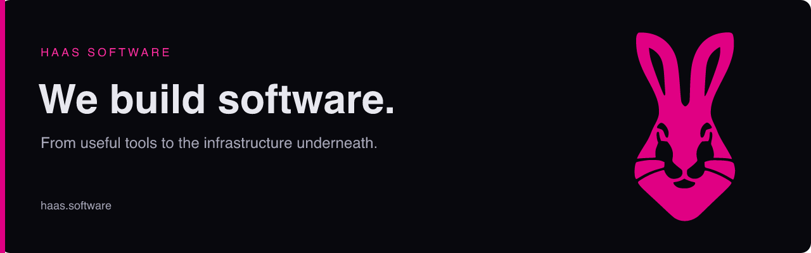

**Useful software. From the interface to the infrastructure.**

We build custom applications, SaaS platforms and tools that make everyday work simpler. Based in the Netherlands, with experience automating business processes since 2012.

[Website](https://haas.software) · [Get in touch](mailto:contact@haas.software) · [Hop infrastructure](https://github.com/hop-os)

### Open source

| Project | What it does |
| :--- | :--- |
| [GoNet](https://github.com/haas-software/GoNet) | Run .NET programs and xunit test suites in pure Go on wazero, without a .NET runtime on the host. |
| [lean](https://github.com/haas-software/lean) | Small Go packages that link only what you ask for. |
| [stulp](https://github.com/haas-software/stulp) | A small, reliable home controller written in Go. |
| [markdown](https://github.com/haas-software/markdown) | A tiny block-based Markdown editor with zero dependencies and optional Alpine.js integration. |

### From software to bare metal

We also build **[HopOS, HOP and SURF](https://gethop.org)**: an operating system, a cluster orchestrator and a distributed desktop. Their source lives in **[@hop-os](https://github.com/hop-os)**.

For custom software, integrations or infrastructure, [let's talk](https://haas.software/#contact).
